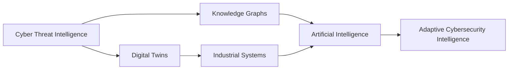

<h1 align="center">OrchiCyb</h1>

Orchicyb is an independent project exploring AI-powered cybersecurity, cyber threat intelligence, modern cyber defense and offensive security through research, software development and educational content.

---

# Current Research

Current focuses are on the intersection of:

- Cyber Threat Intelligence 
- Critical Infrastructure Security
- Industrial Control Systems (ICS)
- Cybersecurity of Humanoid and Autonomous Robotic Systems
- Detection Engineering
- AI Security and AI-assisted Threat Analysis
- Knowledge Graph Reasoning and Obsidian-style visualization
- MITRE ATT&CK, D3FEND, ATLAS
- Operational Technology (OT)
- Digital Twins for Cybersecurity
- Human-AI Collaboration
- Emerging Threat Landscapes

---

# Research Ecosystem

---

# Featured Research

## 🌸 OrchiCyb AI ATTACK

An AI-native Cyber Threat Intelligence platform exploring relationships between:

- Threat Actors
- Campaigns
- Malware
- MITRE ATT&CK
- MITRE D3FEND
- MITRE ATLAS
- Security Controls
- Knowledge Graphs
- AI-assisted Intelligence

➡️ https://github.com/orchicyb/OrchiCyb-AI-Attack

---

## 🌸 OrchiCyb CRITICAL TWIN

An AI-powered Cyber Threat Intelligence Digital Twin for Critical Infrastructure. The platform explores how cyber attacks propagate through industrial environments using interactive Digital Twins inspired by real-world operational technology.

Current industries include:
- Water Treatment
- Electric Grid
- Railway
- Airport
- Port Terminal
- Oil & Gas
- Manufacturing
- Chemical Plant

Research topics include:
- MITRE ATT&CK for ICS
- Purdue Model
- Attack Simulation
- Physical Impact Visualisation
- AI-assisted Incident Analysis
- Operational Consequence Modelling

➡️ https://github.com/orchicyb/Orchicyb-Critical-Twin

---

# Connect

🌐 LinkedIn

https://linkedin.com/company/orchicyb

🌐 Instagram

https://instagram.com/orchicyb
